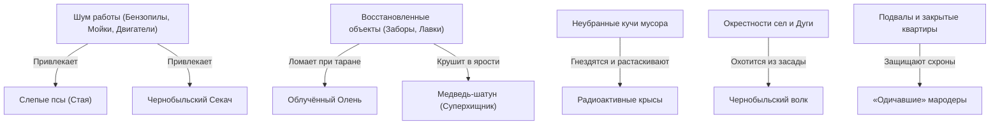
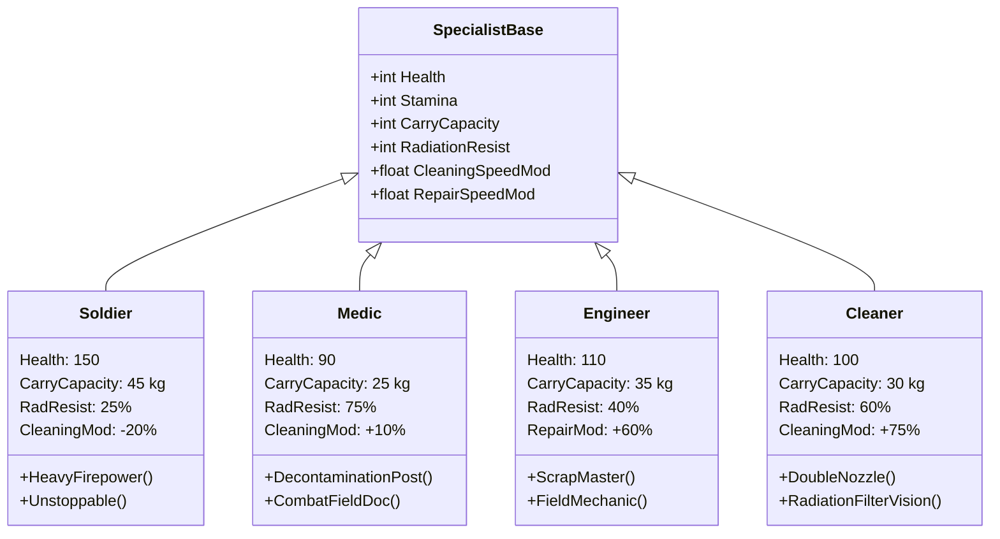

# PRIPYAT / P.R.I.P.Y.A.T — Rebirth of a Forgotten City
## Генеральный документ игрового дизайна (Game Design Document)
*Рабочее название проекта: PRIPYAT (вариант: P.R.I.P.Y.A.T)*

---

## 0. ОСНОВНАЯ КОНЦЕПЦИЯ И АТМОСФЕРА

- **Название:** PRIPYAT / P.R.I.P.Y.A.T — Rebirth of a Forgotten City.
- **Жанр:** First-Person Restoration & Cleaning Simulator / Survival / Tactical Casual.
- **Сеттинг:** Чернобыльская зона отчуждения, город Припять, близлежащие села (Копачи), ЗГРЛС «Дуга» и ЧАЭС (1986+).
- **Камера и перспектива:** Вид от 1-го лица (First-Person).
- **Главный персонаж:** **Специалист / Чистильщик (Cleaner)** — каноничная 3D-модель ликвидатора в защитном прорезиненном костюме, мягком капюшоне и респираторе-визоре.
- **Валюта:** Карбованец (`крб.`).
- **Ключевой посыл:** Реалистичный советский постапокалипсис и медитативный цикл восстановления. Игрок начинает с абсолютного нуля (голыми руками), постепенно очищает дворики, восстанавливает инфраструктуру, защищается от агрессивной облучённой фауны, закупает технику и доходит до очистки самого реактора.

---

## РАЗДЕЛ 1. ОРУЖИЕ И БОЕВЫЕ ХАРАКТЕРИСТИКИ

В игре действует реалистичная баллистика и физика контакта. Игрок начинает с **Кулаков**. Все огнестрельное оружие, огнемёты и боеприпасы приобретаются за заработанные карбованцы.

### Сводная таблица параметров арсенала

| Название | Класс / Калибр | Урон (HP) | Темп огня (выстр/мин) | Обойма | Перезарядка (сек) | Эфф. дальность | Цена (крб.) | Уникальные свойства |
| :--- | :--- | :---: | :---: | :---: | :---: | :---: | :---: | :--- |
| **Кулаки** | Ближний бой | `12` | ~85 уд/мин | — | — | 1.2 м | **0 крб.** *(Старт)* | Тратит 15 ед. выносливости. Отталкивает мелких мобов. Урон снижен по ороговевшей броне. |
| **Лом-гвоздодёр** | Тяжелый металл | `38` | ~65 уд/мин | — | — | 1.6 м | `45 крб.` | Дробящий урон. Вскрывает заколоченные досками двери и стальные замки ящиков с лутом. |
| **Лопата** | Рубящее / Древковое | `42` | ~55 уд/мин | — | — | 2.0 м | `60 крб.` | Повышенная дистанция удара. Двойное назначение: инструмент для расчистки завалов грунта. |
| **Топор пожарный** | Рубящее / Тяжелое | `58` | ~50 уд/мин | — | — | 1.7 м | `85 крб.` | +40% шанс отсечения конечностей и оглушения. Расчищает упавшие балки и деревянный лом. |
| **Пистолет ПЛ** *(ПМ)* | Пистолет / 9х18 мм | `28` | 340 выстр/мин | 8 патр. | 1.4 сек | 25 м | `120 крб.` | Быстрое прицеливание (0.15 сек). Дешевый патрон. Идеальное оружие самообороны. |
| **Пистолет ПТ** *(ТТ)* | Пистолет / 7.62х25 мм | `44` | 280 выстр/мин | 8 патр. | 1.6 сек | 45 м | `190 крб.` | Высокая пробиваемость. Пробивает деревянные заборы и шкуру кабанов без штрафа к урону. |
| **Автомат АЛ** *(АКСУ)* | Легкий автомат / 5.45х39 | `36` | 650 выстр/мин | 30 патр. | 2.1 сек | 60 м | `450 крб.` | Компактный (малый вес в инвентаре). Сильная вертикальная отдача при длинной очереди. |
| **Автомат АТ** *(Абакан)* | Тяжелый автомат / 5.45х39 | `48` | 600 / 1800 (отсечка) | 30 патр. | 2.4 сек | 120 м | `850 крб.` | Сверхточная мгновенная отсечка по 2 патрона в одну точку. Высокая кучность на открытых улицах. |
| **Винтовка ВЛ** *(ТОЗ-8)* | Мелкашка / .22 LR | `55` | Однозарядная (~35 в/м) | 1 патр. | 1.2 сек | 90 м | `160 крб.` | Дешевый бесшумный отстрел крыс, ворон и слепых псов на дальних подступах. |
| **Винтовка ВТ** *(Тяжелая)* | Охотничья / 7.62х54R | `145` | Однозарядная (~22 в/м) | 1 патр. | 2.2 сек | 250 м | `720 крб.` | Огромная останавливающая сила. С одного попадания останавливает несущегося оленя или волка. |
| **Пулемет РПК** | Ручной пулемет / 7.62х39 | `54` | 600 выстр/мин | 40 патр. | 3.6 сек | 100 м | `1 250 крб.` | Подавление огнем. Возможность установки сошек на бордюры и капоты транспорта. |
| **Огнемёт «Пламя-1»** *(Новое!)* | Спецоружие / Огнесмесь | `85/сек` | Поток (струя) | 100 ед. смеси | 4.0 сек | 12 м (конус) | `1 850 крб.` | **Двойное назначение:** боевое оружие и инструмент! Мгновенно выжигает биозаросли, борщевик и коконы; наносит периодический урон горением по стаям мобов. |
| **Гранатомет ГМ** *(РГ-6)* | Тяжелое взрывное / ВОГ-25 | `380` (Splash) | 18 выстр/мин | 6 гранат | 4.5 сек | 80 м | `2 200 крб.` | Колоссальный урон по площади (радиус 6 м). Расчищает завалы бетонных блоков и скопления тварей. |

---

## РАЗДЕЛ 2. МОБЫ (РЕАЛИСТИЧНАЯ ОБЛУЧЁННАЯ ФАУНА И УГРОЗЫ)

Все противники — биологические существа, пострадавшие от радиации, бешенства и мутагенеза. Они осложняют работу, нападают на шум техники и разрушают восстановленные объекты.



### Детальные характеристики бестиария

| Моб | Здоровье (HP) | Урон (DMG) | Скорость бега | Ареал обитания | Вред для процесса восстановления | Награда (крб.) |
| :--- | :---: | :---: | :---: | :--- | :--- | :---: |
| **Радиоактивная крыса** | `20` | `6` (укус) | 3.5 м/с | Мусорные кучи, подвалы | Кусает за руки при сборе мусора; растаскивает собранный хлам обратно. | `3 крб.` |
| **Чернобыльский ворон** | `15` | `8` (пикирование) | 9.0 м/с (полет) | Фонари, крыши пятиэтажек | Пикирует на игрока при переноске открытого мусора, роняет ящики. | `4 крб.` |
| **Слепой пес (Одичавший)** | `65` | `18` (укус) | 6.5 м/с | Дворы, проспекты, скверы | Нападают стаями по 3–5 особей; сбегаются на рев моторов и мойки. | `15 крб.` |
| **Чернобыльский волк** | `130` | `32` (укус) | 7.8 м/с | Лес у села Копачи, ЗГРЛС «Дуга» | Бесшумно атакует со спины одиночных рабочих; накладывает кровотечение. | `35 крб.` |
| **Чернобыльский Секач (Вепрь)** | `320` | `45` (таран) | 7.0 м/с | Сельские дворы, Городской парк | С разбега сносит игрока, выбивает предметы из рук, ломает скамейки и урны. | `75 крб.` |
| **Облучённый Олень** | `210` | `38` (удар рогами) | **9.2 м/с** | Окрестности Дуги, скверы, аллеи | Испуганное и агрессивное животное с гипертрофированными костяными рогами. Разносит свежевысаженные клумбы и ломает деревянные заборы. | `60 крб.` |
| **Медведь-шатун** | **850** | `75` (замах лапой) | 6.8 м/с | Глухие леса у села, промзона ЧАЭС | **Босс локации.** Переворачивает ручные тачки, ломает кузова грузовиков, выдерживает прямое попадание из карабина. | `280 крб.` |
| **«Одичавший» (Мародер)** | `110` | `25` (лом) / `35` (обрез) | 4.8 м/с | Квартиры, темные цеха «Юпитера» | Засели в зданиях; швыряют кирпичи, стреляют из самопалов, крадут сложенный металлолом. | `50 крб.` |

---

## РАЗДЕЛ 3. ИНСТРУМЕНТЫ (ПРОГРЕССИЯ И ЦЕНЫ)

Игрок начинает с **голыми руками**. Все остальные инструменты покупаются в магазинах хозтоваров за карбованцы.

| Инструмент | Цена (крб.) | Эффективность | Ресурс / Расходник | Описание механики применения |
| :--- | :---: | :--- | :--- | :--- |
| **Голые руки** | **0 крб.** *(Старт)* | 1 легкий предмет | Запас сил (выносливость) | Сбор только мелкого мусора (банки, бутылки, картон). Тяжелые предметы не поднять. |
| **Брезентовые рукавицы** | `25 крб.` | Защита рук | Долговечность: 150 сборов | Позволяют брать битое стекло, ржавые консервы и металл без порезов и заражения. |
| **Щетка с металлическим ворсом** | `40 крб.` | 0.4 сек на пятно | Долговечность ворса: 250 очисток | Базовый инструмент соскабливания грязи, мха и копоти на стенах и асфальте. |
| **Совковая лопата** | `60 крб.` | 1.2 сек на кучу | Механическая прочность | Уборка завалов песка, гравия, щебня и выгребание грязи из водостоков. |
| **Штыковая лопата** | `65 крб.` | 1.0 сек на куст | Механическая прочность | Выкапывание корней сорняков, перекопка заброшенных клумб, боевой упор. |
| **Триммер бензиновый** | `280 крб.` | 1.8 м²/сек | Бензин АИ-76 (0.1 л/мин) + Леска | Быстрый покос травы, бурьяна и тростника в скверах и у подъездов. |
| **Бензопила «Дружба-4»** | `450 крб.` | 3.5 сек на ствол | Смесь бензина и масла (0.2 л/мин) | Распил упавших деревьев, расчистка дорог для проезда спецтехники. |
| **Мойка «Вихрь-3000»** | `820 крб.` | 3.5 м²/сек | Бак с водой (15 л) / Шланг от гидранта | Сбивает вековую грязь, сажу и радиоактивный налет на дистанции до 6 метров. |
| **Промышленный пылесос «Буран»** | `650 крб.` | 2.5 м²/сек | Фильтры (сменные, 15 крб.) | Всасывает мелкие осколки стекла, радиоактивную пыль и штукатурку в герметичный бак. |
| **Болгарка (УШМ) электрическая** | `380 крб.` | 2.5 сек на балку | Абразивные диски (по металлу, 8 крб.) | Распил массивных чугунных радиаторов, станков и труб на транспортабельный лом. |
| **Дозиметр «Припять» (ДП-5В)** | `320 крб.` | Радиус 4 метра | Батарейка 1.5В (хватает на 40 мин) | Треском предупреждает об очагах смертельной радиации и фонящих радиодеталях. |
| **Мастерок и шпатель** | `45 крб.` | 2.0 сек на скол | Строительный раствор (мешок 10 крб.) | Заделка трещин, дыр в бетонных панелях и выравнивание стен под покраску. |

---

## РАЗДЕЛ 4. ТРАНСПОРТ (ЛОГИСТИКА И ВЫВОЗ ОТХОДОВ)

| Транспорт | Вместимость | Макс. скорость | Запас прочности (HP) | Расход бензина | Свинцовая защита | Цена (крб.) | Назначение |
| :--- | :---: | :---: | :---: | :---: | :---: | :---: | :--- |
| **Строительная тачка** | 8 мест (120 кг) | 5 км/ч (бег) | `150 HP` | — *(Мускульная сила)* | `0%` | `55 крб.` | Вывоз ящиков из подъездов до дворового контейнера. |
| **Мотороллер «Муравей»** | 20 мест (300 кг) | 45 км/ч | `350 HP` | 4.5 л / 100 км | `10%` | `380 крб.` | Маневренный транспорт для узких дворов и доставки стройматериалов. |
| **УАЗ-452 «Буханка»** | 45 мест (800 кг) | 75 км/ч | `700 HP` | 13.0 л / 100 км | `30%` | `950 крб.` | Мобильная база: внутри верстак для починки оружия и ящик для боеприпасов. |
| **Самосвал ГАЗ-53** | 150 мест (3 500 кг) | 65 км/ч | `1 400 HP` | 24.0 л / 100 км | `25%` | `2 400 крб.` | Массовый вывоз сотен тонн бетона, веток и металлолома во «Вторчермет». |
| **Трактор МТЗ-80 «Беларус»** | Ковш + Щетка | 35 км/ч | `1 800 HP` | 16.0 л / 100 км | `20%` | `3 100 крб.` | Механическая расчистка улиц от завалов земли, сгребание куч мусора. |
| **БРДМ-2 «Ликвидатор»** | 25 мест (герметик) | 80 км/ч | **3 500 HP** | 32.0 л / 100 км | **85%** | `5 800 крб.` | Тяжелый броневик. Защищает экипаж при прорыве к 4-му Энергоблоку ЧАЭС. |

---

## РАЗДЕЛ 5. ЛОКАЦИИ, КАРТА И ТОЧКИ ВЗАИМОДЕЙСТВИЯ (POIs)

### Полный список районов:

```text
[Село Копачи] ──► [1-й Микрорайон] ──► [Пр-т Ленина / Площадь] ──► [Парк и Бассейн] ──► [ЗГРЛС «Дуга»] ──► [Завод «Юпитер» / МСЧ-126] ──► [4-й Энергоблок ЧАЭС]
```

1. **Заброшенное село Копачи (Стартовый пригород):**
   - *Ландшафт:* Песчаные дороги, деревянные избы, колодцы, яблоневые сады, коровники.
   - *Задачи:* Уборка сельхозотходов, спил гнилых заборов, расчистка дороги к городу. Обитают волки, кабаны и крысы. Низкий уровень радиации.
2. **1-й Микрорайон Припяти:**
   - *Ландшафт:* Дворы-колодцы, пятиэтажные хрущевки, детские площадки, подъезды.
   - *Задачи:* Уборка бытового мусора, соскабливание мха с асфальта, остекление первых этажей.
3. **Проспект Ленина и Центральная площадь:**
   - *Ландшафт:* Широкие проспекты, ДК «Энергетик», Гостиница «Полесье», брошенные автобусы.
   - *Задачи:* Расчистка проезжей части, восстановление витражей ДК, запуск уличных фонарей.
4. **Городской парк аттракционов:**
   - *Ландшафт:* Колесо обозрения, автодром, густые дикие заросли.
   - *Задачи:* Покос кустарников, спил аварийных тополей, очистка ржавых каруселей, подача электропитания на колесо.
5. **Бассейн «Лазурный»:**
   - *Ландшафт:* Закрытый спорткомплекс, смотровые вышки, чаша бассейна, спортзал.
   - *Задачи:* Откачка грязной радиоактивной жижи со дна чаши, отмывка плитки мойкой, заделка проломов крыши.
6. **ЗГРЛС «Дуга» (Объект «Чернобыль-2»):**
   - *Ландшафт:* Гигантская 150-метровая стальная стена антенн, плац, казармы, бункер связи с советскими ЭВМ.
   - *Задачи:* Демонтаж аварийных кабелей, сбор сотен тонн радиоактивного металлолома, зачистка территории от стай волков и оленей.
7. **Завод «Юпитер»:**
   - *Ландшафт:* Тяжелые производственные цеха, краны, станочные линии, административный корпус.
   - *Задачи:* Разбор завалов рухнувших перекрытий, распил станков на металлолом, зачистка от вооруженных одичавших мародеров.
8. **Медсанчасть МСЧ-126 (Больница):**
   - *Ландшафт:* Больничные палаты, хирургические блоки, подвал с радиоактивной одеждой первых пожарных.
   - *Задачи:* Дезактивация опасных палат, утилизация зараженной медицинской тары в свинцовые контейнеры.
9. **ЧАЭС: 4-й Энергоблок и Саркофаг («Укрытие») — [Финал]:**
   - *Ландшафт:* Разрушенный реакторный зал, вентиляционная труба ВТ-2, графитовые завалы на крышах, поля смертельной радиации (>100 Р/ч).
   - *Задачи:* Работа только в свинцовых костюмах или на БРДМ. Сбор обломков графита в капсулы, дезактивация бетона, укрепление стен саркофага. Обитает Медведь-шатун.

### Ключевые точки торговли и взаимодействия (Хабы):
- **Штаб Ликвидации:** Доска заказов, карта города, бесплатная койка для сна, ящик хранения.
- **Магазин «Хозтовары»:** Продажа щеток, лопат, моек, мешков, сменных фильтров, стройматериалов.
- **Автобаза «Сельхозтехника»:** Покупка, ремонт, улучшение транспорта, заправка топливом.
- **Пункт приёма «Вторчермет»:** Сдача собранного черного и цветного металла по оптовым ценам.
- **Склад ГО и Военторг:** Продажа оружия, боеприпасов, бронежилетов и гранат.
- **Медпункт РХБЗ:** Продажа индивидуальных аптечек АИ-2, антирадара РД-1, радиопротекторов и костюмов ОЗК/Л-1.

---

## РАЗДЕЛ 6. ЭКОНОМИКА И ЦЕНООБРАЗОВАНИЕ (КАРБОВАНЦЫ)

### Доходы (Вознаграждения):
- **Бытовой мусор (бутылка, банка, газета):** `+2 ... +5 крб.`
- **Картонные коробки, покрышки, ветошь:** `+6 ... +12 крб.`
- **Металлолом (труба, арматура, канистра, радиатор):** `+18 ... +45 крб.`
- **Крупногабаритный лом (станок, кузов легковушки, балка):** `+120 ... +350 крб.`
- **Соскабливание грязи / мха / копоти:** `+1.5 крб.` за квадратный метр.
- **Покос травы и бурьяна триммером:** `+1.0 крб.` за квадратный метр.
- **Распил упавшего дерева бензопилой:** `+40 крб.` за ствол.
- **Ремонт уличного фонаря / скамейки:** `+35 ... +75 крб.`
- **Остекление окна / ремонт подъездного козырька:** `+120 ... +250 крб.`
- **Восстановление трансформаторной будки (запуск света на улице):** `+1 500 ... +3 000 крб.`
- **Сбор радиоактивного графитового обломка в спецкапсулу:** `+150 крб.` за штуку.

### Премии за ликвидацию биоугроз:
- Крыса / Ворон: `+3 ... +4 крб.`
- Слепой пес: `+15 крб.`
- Полесский волк: `+35 крб.`
- «Одичавший» мародер: `+50 крб.`
- Облучённый Олень: `+60 крб.`
- Чернобыльский Секач: `+75 крб.`
- Медведь-шатун (Босс): `+280 крб.`

### Расходы (Цены на припасы):
- Патроны 9х18 мм (пачка 16 шт.): `-20 крб.`
- Патроны 7.62х25 мм ТТ (пачка 16 шт.): `-28 крб.`
- Патроны 5.45х39 мм (пачка 30 шт.): `-45 крб.`
- Патроны 7.62х39 мм РПК (пачка 30 шт.): `-55 крб.`
- Патроны 7.62х54R ВТ (пачка 10 шт.): `-60 крб.`
- Огнесмесь для огнемёта (заправка 100 ед.): `-85 крб.`
- Граната ВОГ-25 для ГМ (1 шт.): `-75 крб.`
- Канистра бензина АИ-76 (20 литров): `-35 крб.`
- Комплект сменных лезвий / дисков для болгарки (3 шт.): `-24 крб.`
- Аптечка АИ-2 (снимает ранения и останавливает кровь): `-25 крб.`
- Препарат «Б-190» (антирадиационный протектор на 10 мин): `-40 крб.`
- Мешок цемента (для шпаклевки и ремонта стен): `-15 крб.`

---

## РАЗДЕЛ 7. ДЕРЕВО ПРОКАЧКИ (ПЕРКИ)

### 1. Ветка «Мастер Чистоты»
- **Уровень 1: «Хваткие пальцы»** — скорость подбора мусора руками увеличена на **+30%**.
- **Уровень 2: «Широкий размах»** — радиус очистки щеткой и лопатой увеличен на **+35%**.
- **Уровень 3: «Взгляд санитара»** — подсвечивает контуром скрытые в траве осколки и пятна грязи на 15 метров.
- **Уровень 4: «Гидроудар»** — мойка высокого давления чистит на **+50%** быстрее и расходует на 40% меньше воды.

### 2. Ветка «Советский Строитель»
- **Уровень 1: «Бережливый мастер»** — расход стройматериалов на ремонт снижен на **-20%**.
- **Уровень 2: «Капитальный ГОСТ»** — отремонтированные заборы и фонари получают **+100%** прочности (не ломаются кабанами).
- **Уровень 3: «Ударник труда»** — скорость починки объектов и монтажа фасадных плит увеличена на **+60%**.
- **Уровень 4: «Электрификация»** — возможность самостоятельно восстанавливать поврежденные электроподстанции и проводку.

### 3. Ветка «Ликвидатор-Ветеран»
- **Уровень 1: «Свинцовые жилы»** — пассивное сопротивление радиации увеличено на **+25%**.
- **Уровень 2: «Тяжелоатлет»** — спринт при переноске тяжелых чугунных батарей и ящиков расходует на **-40%** меньше сил.
- **Уровень 3: «Хладнокровие стрелка»** — отдача всего огнестрельного оружия снижена на **-25%**, смена оружия на инструмент на 35% быстрее.
- **Уровень 4: «Железный иммунитет»** — иммунитет к заражению от укусов крыс и замедление накопления лучевой болезни вдвое.

### 4. Ветка «Механизатор-Логист»
- **Уровень 1: «Экономный карбюратор»** — расход бензина всеми видами транспорта снижен на **-25%**.
- **Уровень 2: «Бортовое наращивание»** — вместимость кузовов тачек, мотороллера и грузовиков увеличена на **+35%**.
- **Уровень 3: «Полевой ремонтник»** — возможность заводить и чинить заглохшую технику без вызова эвакуатора.
- **Уровень 4: «Таранный бампер»** — транспорт наносит втрое больше урона при наезде на мутантов и не повреждает радиатор.

---

## РАЗДЕЛ 8. ПРЕДМЕТЫ МУСОРА И КАТЕГОРИИ ОТХОДОВ

1. **Бытовой сор (легкий):** газеты «Правда», пустые бутылки из-под «Жигулевского», стеклянные банки из-под сока, мятые картонные коробки.
   - *Вес:* 0.2–1.5 кг. *Сбор:* руками в мешок или бросок в контейнер.
2. **Черный и цветной металлолом:** гнутые швеллеры, куски водопроводных труб, чугунные радиаторы, автомобильные рессоры, мотки проволоки.
   - *Вес:* 5–60 кг. *Сбор:* распил болгаркой, погрузка в мотороллер или самосвал, сдача во «Вторчермет».
3. **Строительный бут и стекло:** битый кирпич стен, куски шифера, осколки разбитых витрин магазинов, куски штукатурки.
   - *Вес:* россыпь. *Сбор:* сгребание совковой лопатой или строительным пылесосом «Буран».
4. **Дикорастущая органика:** сухостой, камыш, ядовитый борщевик, мох на бордюрах, упавшие ветки и тополя.
   - *Сбор:* триммер, штыковая лопата, бензопила «Дружба-4», огнемёт.
5. **Въевшаяся грязь и копоть:** многолетний слой радиоактивной пыли на стенах домов, следы пожаров, сажа в котельных.
   - *Сбор:* металлическая щетка со скребком или смыв струей мойки «Вихрь-3000».
6. **Особо опасные отходы («Горячие частицы»):** графитовые блоки реактора, датчики уровня радиации, зараженные шланги пожарных.
   - *Вес:* 2–15 кг. *Сбор:* **ТОЛЬКО** дистанционным захватом в свинцовый контейнер; ручной контакт вызывает лучевой ожог.

---

## РАЗДЕЛ 9. ХАРАКТЕРИСТИКИ КЛАССОВ ПЕРСОНАЖЕЙ



### 1. Специалист / Чистильщик (Cleaner) — [Каноничный главный персонаж]
*Универсал и виртуоз процесса очистки. Протагонист игры по умолчанию.*
- **Базовые характеристики:**
  - Здоровье (HP): `100`
  - Выносливость: **`140`** (Самый выносливый спринтер)
  - Грузоподъемность: `30 кг`
  - Защита от радиации: `60%`
  - Модификатор скорости очистки поверхностей: **`+75%`** (Максимум)
  - Модификатор скорости ремонта: `+15%`
- **Уникальные бафы:**
  - **«Широкое сопло»:** радиус струи мойки высокого давления и ширина захвата щетки увеличены в 2 раза.
  - **«Спектральный визор»:** через светофильтры маски видит радиоактивные пятна и скрытые ядовитые заросли сквозь стены.
  - **«Передовик пятилетки»:** получает на +20% больше карбованцев за каждый полностью очищенный сектор.
- **Слабости:**
  - Тканевый костюм с капюшоном плохо защищает от дробящих ударов (получает +25% урона от когтей медведей и клыков секачей).

### 2. Штурмовик (Soldier)
*Тяжелая охрана группы, мастер огневого боя и прорыва периметров.*
- **Базовые характеристики:**
  - Здоровье (HP): **`150`** (Самое высокое)
  - Выносливость: `100`
  - Грузоподъемность: **`45 кг`**
  - Защита от радиации: `25%`
  - Модификатор скорости уборки: `-20%` (штраф за тяжелые перчатки)
  - Модификатор скорости ремонта: `0%`
- **Уникальные бафы:**
  - **«Твердая рука»:** -30% к отдаче пулемета РПК и автоматов, перезарядка оружия на 25% быстрее.
  - **«Неудержимый»:** иммунитет к сбиванию с ног при лобовом таране кабана или ударе оленя.
  - **«Тяжеловес»:** может нести чугунную батарею или двигатель и одновременно отстреливаться из пистолета.
- **Слабости:**
  - Высокий расход выносливости при работе совковой лопатой и триммером.
  - Высокая уязвимость к фоновой радиации без поддержки медика.

### 3. Медик (Medic)
*Эксперт радиационной безопасности, детоксикации и выживания в экстремальных зонах.*
- **Базовые характеристики:**
  - Здоровье (HP): `90` (Хрупкий)
  - Выносливость: `115`
  - Грузоподъемность: `25 кг`
  - Защита от радиации и химикатов: **`75%`** (Самая высокая)
  - Модификатор скорости уборки: `+10%`
  - Модификатор скорости ремонта: `-15%`
- **Уникальные бафы:**
  - **«Санитарный пост»:** может развернуть мобильную стойку деконтаминации, быстро смывающую радиацию со всей бригады.
  - **«Полевой хирург»:** аптечки лечат союзников на +50% эффективнее и мгновенно останавливают кровотечение.
  - **«Иммунный щит»:** полный иммунитет к токсинам и трупным ядам при укусах крыс.
- **Слабости:**
  - Низкий запас физического здоровья (быстро погибает при окружении стаей псов).
  - +40% к разбросу пуль при стрельбе из тяжелого оружия (РПК, тяжелые винтовки).

### 4. Инженер (Engineer)
*Главный по ремонту архитектуры, проводке, оживлению транспорта и разделке металлолома.*
- **Базовые характеристики:**
  - Здоровье (HP): `110`
  - Выносливость: `105`
  - Грузоподъемность: `35 кг`
  - Защита от радиации: `40%`
  - Модификатор скорости уборки: `0%`
  - Модификатор скорости ремонта зданий: **`+60%`**
- **Уникальные бафы:**
  - **«Вторчермет-бонус»:** распиливает металлолом болгаркой на 50% быстрее и получает +25% карбованцев при сдаче лома.
  - **«Полевой механик»:** восстанавливает двигатели и колеса транспорта прямо в поле без затрат на эвакуатор.
  - **«Золотое сечение»:** экономит 30% цемента, стекла и досок при восстановлении зданий и фонарей.
- **Слабости:**
  - Медленный темп при сборе мелкого мусора руками.
  - Средние стрелковые показатели (эффективен только на ближней дистанции с ломом и дробовиком/пистолетом).
